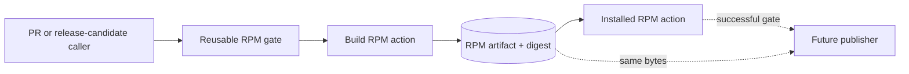

# RPM CI/CD building blocks

The Agent repository builds and verifies RPMs through reusable GitHub Actions
components. Pull-request checks, release-candidate checks, and a future package
publisher all consume the same build contract instead of copying shell steps.

## Design

The automation has three layers:

1. `packaging/rpm/*.sh` contains the commands and remains runnable locally.
2. `.github/actions/` exposes those commands as repository-local composite
   actions.
3. Reusable workflows own artifact transfer and job topology. Triggered
   workflows are intentionally small callers.

The RPM is built once. Its binary RPM, source RPM, checksums, and structured
metadata are uploaded under one artifact name. The installed-package job
downloads that exact artifact, verifies its checksum, installs it in a clean
Fedora container, verifies the package identity, files, ownership, import root,
and systemd unit, records evidence, and removes the package. A later
publication job must consume the already tested artifact rather than rebuild
it.



## Local parity

Build an RPM with the same command used by the composite action:

```console
packaging/rpm/build-rpm.sh
```

Install and verify the resulting binary RPM in clean Fedora:

```console
packaging/rpm/test-installed-rpm.sh \
  --rpm dist/rpm/stateforge-agent-0.1.0-1.fc42.noarch.rpm
```

Both commands require Docker. The installed-package container receives the
RPM and an evidence directory, but it does not mount the source checkout. This
prevents an import from the checkout from masquerading as an installed-package
success.

## Reuse

- `reusable-rpm-build.yml` builds once and publishes the immutable artifact.
- `reusable-rpm-test.yml` downloads and tests that artifact.
- `reusable-rpm-gate.yml` composes both jobs and returns the tested artifact
  name, version, and SHA-256 digest.
- `rpm-ci.yml` is the thin pull-request and integration-branch caller.
- `rpm-release-candidate.yml` is the thin manual pre-publication caller.

A future publishing workflow should depend on the reusable gate and download
`${{ needs.rpm.outputs.artifact-name }}`. It must not invoke the build action a
second time.

External actions are pinned to immutable commit SHAs, workflows use read-only
repository permissions, checkout credentials are not persisted, and no
production credentials enter build or test jobs.

## Packaging boundary

`stateforge-protocol` and the Agent's other Python dependencies are not yet
distributed as system RPMs. This packaging gate therefore installs the Agent
RPM with dependency resolution disabled and verifies only the artifact-owned
package surface. It does not claim that the daemon can start without its
runtime dependencies.

Runtime and Provider integration workflows should consume this same tested RPM
artifact, install their version-pinned dependency artifacts, and then start the
service. Once all runtime dependencies are available as distribution packages,
the installed-package action can use the system package manager and add a
service-start assertion without changing how callers build or pass the RPM.
