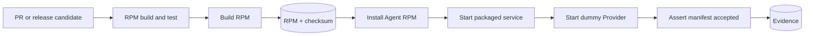

# Agent package CI/CD library

The repository exposes a small GitHub Actions library for building the Agent
RPM and exercising it as installed software against an independent Provider
process. Event workflows select when a pipeline runs; callable workflows own
job topology and artifact transfer; domain actions own one reusable lifecycle
operation.

## Structure

```text
.github/
├── actions/
│   ├── rpm/
│   │   ├── build/
│   │   └── test-installed/
│   │       ├── setup/
│   │       ├── cleanup/
│   │       ├── smoke/
│   │       │   └── manifest-exchange/
│   │       ├── capability/
│   │       │   └── assessment/
│   │       ├── lifecycle/
│   │       │   └── multiple-providers/
│   │       ├── health/
│   │       │   └── provider-availability/
│   │       ├── adversarial/
│   │       │   └── invalid-descriptor/
│   │       └── destructive/
│   │           └── uninstall-reinstall/
│   ├── agent/
│   │   ├── assert-availability/
│   │   ├── assert-capability-assessment/
│   │   ├── install/
│   │   ├── start/
│   │   └── collect-evidence/
│   └── provider/
│       ├── create-fixture/
│       ├── set-health/
│       ├── start/
│       ├── stop/
│       └── assert-manifest/
└── workflows/
    ├── rpm-build.yml
    ├── rpm-installed-test.yml
    ├── rpm-build-and-test.yml
    ├── rpm-ci.yml
    └── rpm-release-candidate.yml
```

GitHub requires workflow files to live directly in `.github/workflows`, so
workflow names describe their capability rather than carrying a `reusable-`
prefix. Composite actions can be nested and form the discoverable domain
library.

## Installed-system path

The RPM, Protocol package, and Provider package are each built once through
the build action owned by their repository. The installed-system matrix
downloads those exact bytes, then performs this sequence:

1. Select and check out the requested Protocol and Provider revisions.
2. Invoke Protocol's `python/build` and Provider's `package/build` actions.
3. Record their commits and package hashes in one immutable fixture bundle.
4. Start a clean Fedora systemd container with no source checkout mounted.
5. Verify and install the Agent RPM.
6. Install the matching Protocol and Provider wheels and third-party runtime
   dependencies.
7. Start the packaged `stateforge-agent.service` unit.
8. Start a real Provider Python fixture as a separate non-root systemd
   service.
9. Wait for the Agent to accept that Provider's manifest and Provider-wide
   Health Watch state.
10. Prove the CLI, imported Python distribution, and RPM versions agree and
   that RPM owns the imported module.
11. Capture bounded journals, process state, descriptors, package ownership,
   and package verification evidence.
12. Stop services, uninstall the RPM, verify removal, and remove the container.



No Agent or Provider source directory is mounted into the test system. The
Agent executable and package must be owned by the RPM. The Provider and
Protocol are built into wheels once before the scenario matrix because
`stateforge-provider` and `stateforge-protocol` are not yet
published to PyPI. Those wheels are installed into the test system; their
source checkouts are never used as import roots.

The dependency-build job is the only job with source-repository credentials.
It invokes the portable build action from each selected checkout, validates
the action-produced checksum manifests, and uploads one fixture artifact.
Every scenario downloads and validates that same artifact instead of rebuilding
packages or receiving a GitHub token.

Because those source repositories are private, the installed-test workflow
mints a short-lived installation token from a dedicated GitHub App. Configure
the repository secrets `STATEFORGE_CI_APP_ID` and
`STATEFORGE_CI_PRIVATE_KEY`; install that App on only
`stateforge-protocol` and `stateforge-provider-python` with read-only
Contents permission. The token is scoped to those two repositories, is not
persisted by checkout, and expires automatically. A long-lived personal
access token is neither required nor accepted by the workflow interface.

The installed-system workflow currently runs ten isolated scenarios:

- smoke: one public-API Provider completes manifest exchange;
- capability: the RPM-installed Agent retries one deterministic transient
  failure before assessing a real Provider Python process over its Unix-domain
  SFP socket; it refreshes evidence after an operation-specific environment
  change, remains available while appropriate, fails closed across a
  Provider-wide Health transition, invalidates stale evidence, and proves that
  the target is unchanged and no operation runs;
- capability boundary cases: isolated clean-container jobs prove the installed
  client deadline, malformed-wire rejection, session/generation/manifest
  correlation, and request/response byte limits;
- lifecycle: two independent Provider processes are accepted concurrently;
- health: real Providers drive initial replay, loss, recovery, concurrent
  Watch streams, shutdown, and same-installation generation replacement;
- adversarial: malformed discovery data is rejected without stopping the Agent;
- destructive: the exact RPM is removed, installed again in a clean environment,
  and completes manifest exchange after reinstallation.

For reproducible release-candidate runs, pass commit SHAs as `provider-ref`
and `protocol-ref`. Integration CI defaults to each repository's
`mvp/implementation` branch so it continuously tests the current integrated
contract. Every scenario retains `dependency-provenance.json`, which records
both requested refs, the exact commits resolved by checkout, and the SHA-256
digest of each generated wheel.

## Action responsibilities

| Action | Responsibility |
| --- | --- |
| `rpm/build` | Build binary/source RPMs, checksums, metadata, and exact source provenance from the Agent checkout that owns the action. |
| `rpm/test-installed/setup` | Prepare a clean RPM-installed Agent for one scenario. |
| `rpm/test-installed/<tier>/<scenario>` | Run one isolated installed-system scenario and its assertions. |
| `rpm/test-installed/cleanup` | Preserve evidence and remove the scenario environment. |
| `agent/install` | Create clean Fedora, install the exact RPM and dependencies, and verify package ownership. |
| `agent/start` | Start the packaged systemd unit and wait for an explicit readiness event. |
| `agent/assert-availability` | Assert an exact Provider generation reached a local eligibility state. |
| `agent/assert-capability-assessment` | Use the RPM-installed Agent package to collect and verify normalized evidence from a separate real Provider process. |
| `agent/assert-capability-boundary` | Exercise timeout, malformed response, stale response-fence, and byte-limit behavior through the RPM-installed client. |
| `agent/collect-evidence` | Capture bounded evidence, uninstall the RPM, and clean up. |
| `provider/create-fixture` | Invoke the selected Protocol and Provider checkouts' canonical package-build actions and stage their wheels with a selected fixture. |
| `provider/start` | Run the fixture as a separate non-root systemd service. |
| `provider/set-health` | Drive a deterministic public Provider Health transition. |
| `provider/stop` | Stop one fixture through its systemd unit. |
| `provider/assert-manifest` | Assert the Agent accepted the Provider manifest. |

The fixture itself is intentionally small Python test data because the public
Provider authoring API is Python. Provisioning, service control, readiness,
evidence, and cleanup are not implemented in a second Python framework. Shell
is retained only where the behavior being controlled is inherently Linux,
RPM, Docker, or systemd behavior.

## Workflows

- `rpm-build.yml` builds and uploads one immutable RPM artifact.
- `rpm-installed-test.yml` builds one immutable Provider fixture artifact,
  downloads the RPM and fixture artifacts, and runs the installed
  Agent/Provider scenario matrix.
- `rpm-build-and-test.yml` composes the two jobs and exposes the tested
  artifact name, version, and SHA-256 digest.
- `rpm-ci.yml` is the thin pull-request and integration-branch entry point.
- `rpm-release-candidate.yml` is the thin manual pre-publication entry point.

A publishing workflow must consume the artifact returned by
`rpm-build-and-test.yml`. It must not rebuild the RPM after testing.

## Adding an installed-system scenario

Each independently runnable scenario is a composite action under
`.github/actions/rpm/test-installed/<tier>/<scenario>/`. A scenario composes
the shared `setup` and `cleanup` actions with only the Provider behavior and
assertions that distinguish that case. The reusable workflow gives every
scenario its own job and clean container, so one failure cannot contaminate a
later scenario.

Use one of the `smoke`, `capability`, `lifecycle`, `health`, `adversarial`, or
`destructive` tiers. A scenario action must always invoke cleanup with
`always()` so failure
evidence is retained. Adding a normal scenario requires one action and one thin
workflow job; it must not duplicate RPM installation, systemd readiness,
evidence, or environment cleanup commands.

## Adding a Provider fixture

Add a Python file under
`.github/actions/provider/create-fixture/fixtures/`. The file must use only
the public `stateforge_provider` authoring API and read lifecycle paths from the
environment variables supplied by `provider/start`. Select the file through
the scenario setup action's `fixture` input. No container, service-control, or
evidence code is required for a normal fixture.

## Local RPM build

The packaging implementation remains locally runnable because RPM creation is
useful outside GitHub Actions:

```console
packaging/rpm/build-rpm.sh
```

The RPM action is also safe to invoke from another repository. The consumer
chooses and checks out the exact Agent revision, then calls the action from
that checkout. Output paths remain relative to the caller workspace and are
normalized before the action enters the Agent source tree:

```yaml
- uses: actions/checkout@<immutable-sha>
  with:
    repository: stateforge-org/stateforge-agent
    ref: <agent-ref-or-commit>
    path: .stateforge-ci/agent
    persist-credentials: false

- uses: ./.stateforge-ci/agent/.github/actions/rpm/build
  with:
    output-directory: dist/agent-rpm
```

The resulting `build-metadata.json` records the exact Agent commit and ref.
Checkout and ref selection deliberately remain the consumer's responsibility;
the builder always builds the repository snapshot containing the action.

The complete installed-system sequence is intentionally assembled from GitHub
Actions rather than duplicated in a local Python or shell harness. Each action
contains the command it owns, and the CI run retains the resulting evidence.

External actions are pinned to immutable commit SHAs, workflows use read-only
repository permissions, and checkout credentials are not persisted. Build and
test jobs receive no production credentials.
