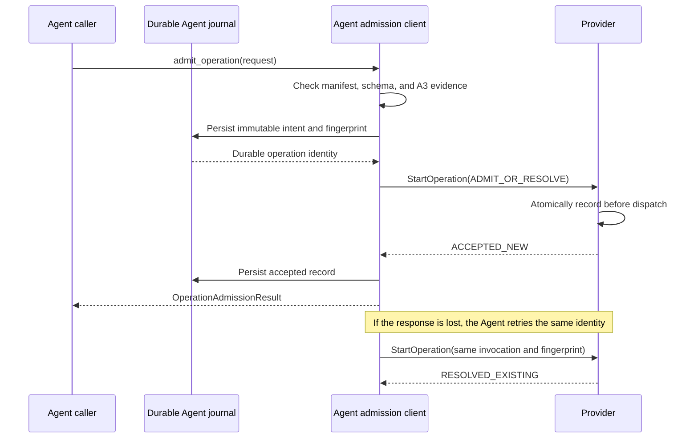

# Operation Admission

The Agent uses SFP Operation Admission to submit one authorized, immutable
operation intent to an eligible Provider. The Provider either creates the
operation record and dispatches the handler, or resolves the same durable
identity to the record it created earlier.

Operation Admission does not define authorization policy or operation
progress. The caller authorizes the request before entering this boundary;
later SFP procedures report execution state, results, and cancellation.

## Agent API

`ProviderSessionManager.admit_operation` accepts an
`OperationAdmissionRequest` containing:

- the Provider installation identity;
- the manifest-declared operation identifier;
- the exact JSON payload and execution context;
- a finite execution deadline.

The Agent allocates the operation UUID, binds it to the immutable request
fingerprint, and persists that intent before contacting the Provider. The
caller never supplies or reuses an arbitrary operation UUID.

Admission requires the exact current Provider session to be available. The
operation must be declared in the accepted manifest, its payload must satisfy
the declared Draft 2020-12 schema, and the current Capability Assessment must
cover the same operation and execution context with an admissible support state.

## Uncertain outcomes

A transport failure does not prove that the Provider rejected the operation.
The Provider may have committed and dispatched it before the response was
lost. The Agent therefore preserves the original identity and immutable
content instead of creating another operation.

| Situation | Agent behavior |
| --- | --- |
| Response is lost on the current session | Retry the exact request with the same operation UUID and fingerprint. |
| Provider already recorded the request | Accept `RESOLVED_EXISTING`; do not create a second operation. |
| Reconnection creates a new session | Use resolve-only recovery for the existing identity. |
| Provider cannot prove the retained record | Keep the outcome unresolved; never silently admit a replacement operation. |
| Same identity is bound to changed content | Reject the local conflict before transport. |

The durable record survives Agent restart. Until later lifecycle procedures
complete, an unresolved admission remains explicit Agent responsibility.

## Bounds and safety

Three Provider settings bound transport retry behavior:

- `providers.operation_admission_timeout_seconds` sets the finite deadline for
  each RPC attempt;
- `providers.operation_admission_attempts` limits attempts to between 1 and 5;
- `providers.operation_admission_retry_initial_delay_seconds` sets the initial
  bounded retry delay.

`journal.maximum_unresolved_operation_admissions` limits durable intents whose
remote outcome is not yet proven. When the limit is reached, the Agent rejects
new intents before contacting a Provider.

Canonical message sizes, fingerprints, response correlation, error details,
and status mappings come from `stateforge-protocol`. Payload and execution
context values are retained only in the durable journal and wire request; they
are not copied into logs, exception text, or CI evidence.

## Installed verification

The installed-system scenario builds the Agent RPM and exact Protocol and
Provider wheels, then starts the packaged Agent and two real Provider Python
processes as separate systemd services. One Provider completes a normal
admission while the other deliberately loses its first successful response
and resolves the Agent's identical retry from its existing record.

The scenario proves that:

- malformed, undeclared, oversized, expired, or unsupported requests are
  rejected before unsafe dispatch;
- simultaneous admissions remain isolated to their selected Provider;
- one immutable request is sent twice with the same operation UUID and digest;
- each real Provider handler runs exactly once per admitted identity;
- the Agent receives `RESOLVED_EXISTING` after the simulated response loss;
- a lost response followed by Provider generation replacement uses
  `RESOLVE_ONLY`, preserves the original identity, and remains unresolved when
  the replacement process cannot prove retained state;
- accepted and unresolved records survive an Agent service restart; and
- journals and retained CI evidence contain identifiers and hashes, never
  sensitive operation payload values.

## Profile ownership

Providers declare concrete operation input/result schemas and trigger payload
schemas. The Agent retains these declarations for execution validation and a
future SF-AOP handoff to the Control Plane; that connection is not implemented.
Profile definitions, automatic or assisted schema matching, field mappings,
partial-match discovery, and Contract fulfillment belong in the Control Plane.
Compatible types and constraints can support mappings even when field names
differ. Extra outputs and optional or supplied extra inputs do not by themselves
disqualify a capability; additional mandatory inputs must be supplied before
execution. A JSON Schema `default` annotation does not materialize a value.
Schema compatibility does not prove behavioral compliance.
