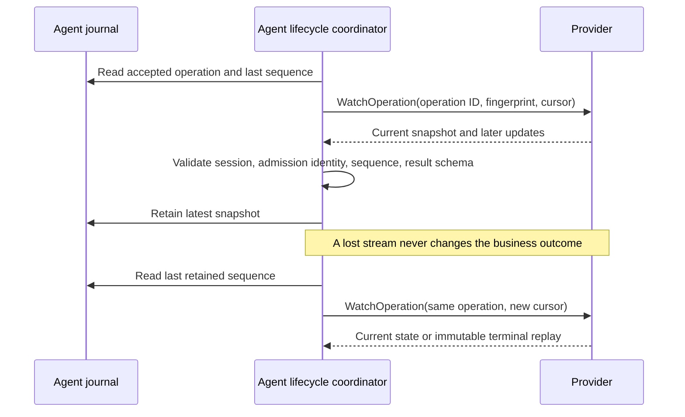

# Operation Lifecycle

After Operation Admission proves that a Provider accepted an operation, the
Agent watches that operation's current state through SFP. Watching does not
start execution again. It uses the admission record's operation ID and request
fingerprint, and it resumes from the last sequence retained in the Agent
journal.

## Local status

`ProviderSessionManager.operation_status(provider_instance_id, operation_id)`
returns the Agent's durable local `OperationStatus`, or `None` for an unknown
identity. It does not make a Provider call. The status separates admission
from execution state and includes the latest sequence and progress, a typed
successful result, or a structured failure/cancellation outcome with side
effects and cleanup evidence. A known accepted operation without a retained
snapshot has an unknown execution state; the Agent does not infer success or
failure from admission alone.

Only accepted records with a pinned result schema are watched. The Agent
validates each terminal success against the result schema captured at
admission, even if a later manifest revision changes the declaration. The
journal preserves one latest snapshot, not an unlimited progress history.
It rejects conflicting snapshots at the same sequence and never replaces a
terminal outcome.

## Cancellation

`ProviderSessionManager.cancel_operation(provider_instance_id, operation_id)`
requests cooperative cancellation of one admitted operation. The Provider's
response distinguishes `REQUESTED`, `ALREADY_REQUESTED`, `UNSUPPORTED`, and
`ALREADY_TERMINAL`. `REQUESTED` means the Provider has received the request;
it does **not** mean execution has stopped. Only a validated terminal
`CANCELLED` snapshot confirms cancellation. Success or failure may win the
race after a cancellation request, and the Agent retains that actual terminal
outcome. A timeout, lost Watch, Agent restart, or health loss does not
fabricate a terminal state or cancel unrelated operations.

## Interruption and recovery

The coordinator bounds simultaneous Watch calls. On a retryable stream
failure it reconnects to the same admitted identity using the last durable
sequence; on a replacement Provider session it uses the new session fences.
Observer interruption changes no business execution. When the packaged Agent
restarts, it scans accepted nonterminal records and resumes observation after
establishing a current Provider session. Complete state-loss reconciliation
belongs to the later Disconnection and Recovery milestone.

The installed-system scenario uses the exact Agent RPM plus Protocol and
Provider wheels. It verifies real progress, typed success, structured failure,
cooperative cancellation, unsupported and already-terminal decisions,
resumption after Agent service restart, and exactly one Provider dispatch per
operation identity.
