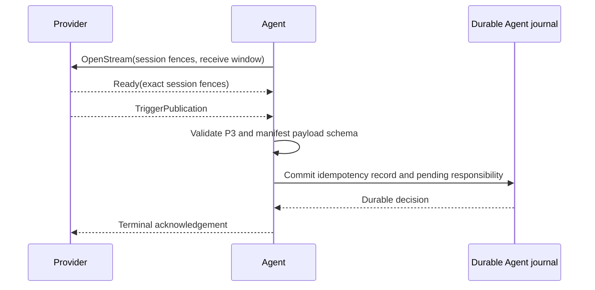

# Trigger Publication

The Agent consumes Provider-originated events through the StateForge Protocol
Trigger Publication procedure. A stream is opened only for a Provider session
that has an accepted manifest and currently reports `SERVING` through its
Provider-wide Health Watch.

## Acceptance boundary

For every publication, the Agent applies these checks in order:

1. Validate the canonical P3 message, identifiers, timestamp, JSON value, and
   serialized-message limits owned by `stateforge-protocol`.
2. Require the trigger identifier to exist in the exact accepted Provider
   manifest.
3. Validate the payload against that declaration's Draft 2020-12 JSON Schema.
4. Commit the immutable publication and its content fingerprint to the Agent
   journal.
5. Recheck that the Provider session, manifest, and availability generation
   are still current.
6. Return one terminal acknowledgement to the Provider.

The acknowledgement is never sent before the journal commit. A lost
acknowledgement therefore causes a safe Provider replay rather than a lost
event.

## Durable decisions

The idempotency key is the Provider installation identity together with the
Provider-minted publication ID.

| Existing journal state | Agent decision |
| --- | --- |
| No matching key and capacity is available | Commit the publication and return `ACCEPTED_NEW`. |
| Same key and same canonical content fingerprint | Return `ACCEPTED_DUPLICATE`. |
| Same key with different content | Reject the publication as an idempotency conflict. |
| No matching key and the pending-responsibility limit is full | Return a retryable capacity rejection. |

Accepted records remain in
`/var/lib/stateforge-agent/journal/agent.db`. They retain the deterministic
protobuf bytes, content fingerprint, trigger identifier, Provider/session
fences, acceptance time, and forwarding state. Payloads are not written to
logs or error messages.

The current milestone stops at durable local acceptance. Accepted records are
marked `pending` for the future SF-AOP forwarding boundary; they are not
deleted or presented as delivered to the Control Plane.

## Stream lifecycle

Only one Trigger Publication consumer is active for an eligible Provider
session. The stream is cancelled when Health is lost, the endpoint is
replaced, the descriptor is removed, the channel fails, or the Agent shuts
down. Every callback is fenced to the exact Provider installation, endpoint
generation, session, manifest revision, and availability generation that
opened it, so stale streams cannot commit new responsibility.

Transient transport failures are retried with the Agent's bounded reconnect
backoff. Canonical protocol violations and stale ready responses terminate the
attempt without accepting data. Provider replay across stream loss or Agent
restart is resolved by the durable idempotency record.

## Bounds

Two configuration values keep local responsibility explicit:

- `providers.trigger_max_in_flight_publications` selects the receive window
  advertised to each Provider stream;
- `journal.maximum_pending_trigger_publications` limits the number of
  accepted publications awaiting the future forwarding boundary.

Both values must be positive and must not exceed the canonical P3 limits
published by `stateforge-protocol`.
